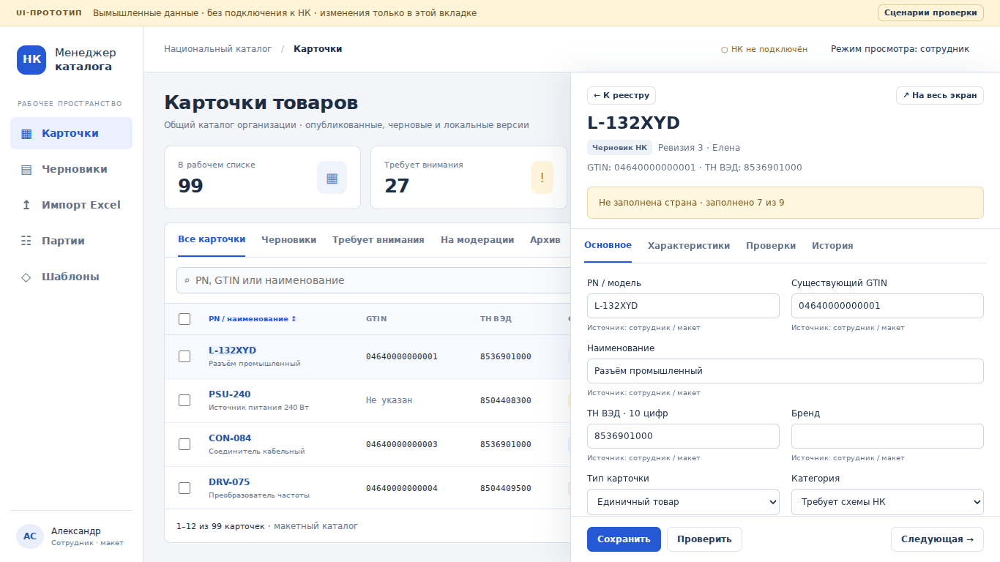

# nk-manager

Менеджер российского Национального каталога «Честного знака» для создания карточек и дозаполнения существующих черновиков.

**Текущая поставка: этап 1 — интерактивный UI/UX-прототип на согласование.** Рабочее приложение и интеграция НК ещё не реализованы. Согласно разделу 18 ТЗ, переход к backend и бизнес-логике разрешён после согласования интерфейса владельцем проекта.

## Посмотреть интерфейс

Скачайте [prototype/preview.html](prototype/preview.html) и откройте в браузере: это автономный файл, установка и интернет не нужны. GitHub показывает исходный код HTML; используйте Download raw file.

Либо запустите из корня репозитория:

```bash
python -m http.server 8765 --bind 127.0.0.1
```

Откройте `http://127.0.0.1:8765/prototype/`. Это локальный сервер просмотра, не конфигурация развёртывания продукта. Порт можно заменить любым свободным.

В прототипе доступны:

- реестр из 108 вымышленных карточек: поиск, фильтры, сортировка PN, выбор между страницами;
- правая панель, полноэкранный режим, вкладки, локальное редактирование и предупреждение о несохранённом вводе;
- создание локальной карточки, сравнение PN с причиной решения, массовый предпросмотр и локальный архив;
- четырёхшаговый мастер Excel на встроенном примере, шаблоны и diff, партия с частичными результатами;
- просмотр административных экранов через переключатель роли, отдельные сценарии ошибок.

Полоса «UI-ПРОТОТИП» остаётся видимой. Нет сетевых запросов к НК, загрузки реальных файлов, выдачи GTIN, подписи, БД, серверной авторизации или производственной очереди. Все изменения исчезают при перезагрузке страницы. Переключатель роли показывает структуру экрана и не предоставляет настоящих полномочий.



[Все скриншоты](docs/SCREENSHOTS.md) · [Браузерный отчёт: 13 групп проверок](docs/browser-report.json)

## Что проверить перед согласованием

1. Найти PN, открыть карточку справа, развернуть, изменить поле, сохранить, перейти к следующей.
2. Выбрать карточки на двух страницах и открыть «Применить шаблоны» и «Отправить…».
3. Открыть «Проверить», сравнить PN и подтвердить другой товар с причиной.
4. Пройти импорт, открыть шаблоны и партии, посмотреть ошибки и остановку.
5. Переключить просмотр администратора и открыть его разделы.

Согласование касается компоновки и сценариев, а не достоверности вымышленных товарных характеристик. Результат фиксируется в [docs/UX-ACCEPTANCE.md](docs/UX-ACCEPTANCE.md).

## Проверки и сборка

Исходники прототипа: `prototype/index.html`, `style.css`, `app.js`. Автономный файл собирается детерминированно:

```bash
python scripts/build_preview.py
npm ci
npx playwright install chromium
npm test
```

Тест запускает свой loopback-сервер на свободном порту. Скриншоты и JSON-отчёт: `docs/screenshots/` и `docs/browser-report.json`. Проверяется статический прототип, не интеграция НК.

## Следующие этапы

После согласования: FastAPI, серверные сессии и роли, SQLite WAL, атрибутные схемы и версии, аудит, импорт/экспорт, read-only синхронизация. Реальные внешние операции подключаются только после получения точного контракта API и разрешения владельца на пилот. Неподтверждённые endpoint'ы в код не добавлены.

- [Исследование возможностей API](docs/API-CAPABILITIES.md)
- [Архитектурные решения и доноры](docs/ARCHITECTURE.md)
- [Спецификация интерфейса](docs/UX-SPEC.md)
- [Статус согласования UX](docs/UX-ACCEPTANCE.md)
- [Отчёт о поставке](docs/IMPLEMENTATION.md)
- [План приёмки](docs/ACCEPTANCE.md)
- [Исходное ТЗ](docs/TASK.md)
