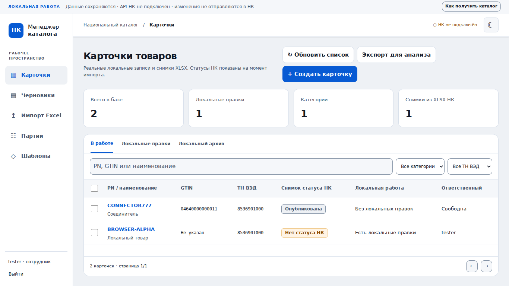

# nk-manager

Рабочее место для локальной подготовки карточек российского Национального каталога «Честного знака».

**Версия 0.7.0:** постоянная SQLite, прямое API российского НК, синхронизация, схемы атрибутов, создание/обновление, отдельное выделение GTIN, модерация и публикация через Windows/CryptoPro. Подписант перенесён из marking-bm. Внешние действия подтверждаются отдельно и проверяются повторным чтением; неопределённый результат не повторяется автоматически.

[Обновление вашей WSL2-установки и подключение подписи](docs/NK-LIVE.md). Реальный ключ организации и аппаратная УКЭП в нашей среде отсутствуют: промышленный пилот предстоит выполнить у владельца. Создание/редактирование комплектов и наборов пока заблокировано.

## Запуск в WSL2

Из домашнего каталога Ubuntu/WSL2, Python 3.12:

```bash
sudo apt update && sudo apt install -y python3.12-venv
git clone --branch codex/nk-live https://github.com/AlexSapronov/nk-manager.git
cd nk-manager
python3 -m venv .venv && .venv/bin/python -m pip install -r requirements-lock.txt
.venv/bin/python scripts/setup.py
.venv/bin/python scripts/run_wsl.py
```

Откройте **http://localhost:8020** в браузере Windows. Настройка попросит username и **личный пароль первого администратора от 8 символов**. Все пользователи входят по собственному паролю. В админке создайте сотрудника, передайте ему отображённый один раз код: при первом входе сотрудник вводит код и дважды задаёт свой пароль (минимум 8 символов, без требований к регистру или спецсимволам). Администратор может сбросить пароль любого пользователя и получить новый одноразовый код.

Если репозиторий уже скачан, не клонируйте поверх: используйте переключение ветки по [инструкции WSL2](docs/WSL.md). Если порт занят — `--port 8021`; чужие сервисы не останавливаются. Данные: `data/nk-manager.sqlite3`, исходные XLSX и аудит включены в ту же базу. Следующий запуск требует только последней команды.

Сервер слушает loopback и работает с одним worker без autoreload. Для внешнего корпоративного развёртывания нужен отдельный HTTPS/reverse proxy; приведённые команды предназначены для локального Windows/WSL2.

## Что уже работает

- [11 встроенных шаблонов](presets/README.md): активны после обновления, ОКПД2 — самый частый по ТН ВЭД; ручная загрузка JSON не нужна.

- Серверные сессии на 14 дней с продлением при активности, личные пароли и одноразовые коды установки, отдельные полномочия администратора, CSRF/Origin, ограничение попыток входа.
- Общий каталог, поиск PN/GTIN/названия, категории/ТН ВЭД, выбор между страницами, локальный архив.
- Создание и редактирование с ревизиями, ответственным, проверкой совпадений и причиной продолжения.
- Импорт XLSX: лист/заголовки, сопоставление, общие значения, предварительная проверка, явный выбор и результаты каждой строки.
- Исходный файл, сырые строки и происхождение характеристик; повторный файл защищён SHA-256; локальные правки не затираются импортом.
- Экспорт JSON/XLSX/ZIP для внешнего анализа, манифест SHA-256, история экспорта.
- Предложения шаблонов, версии, локальное утверждение администратором и откат версии; дозаполнение только существующих пустых полей по точной области применения.
- Общий дизайн gis-trueapi/km-split/marking-bm, светлая и тёмная темы.
- Backup/restore в новый путь с проверкой целостности; hash assets, версия/commit/схема БД в диагностике.



Скриншот снят с настоящего локального сервиса на изолированных входных данных теста. При вашей установке этих товаров нет.

## Создание по эталону

«Создать карточку»: укажите PN, полный ТН ВЭД и товарный знак, затем выберите вид товара из опубликованных образцов. Полное наименование формируется как **PN + пробел + вид товара**, без перестановки слов. Проверьте заполненные значения и сохраните локальный черновик. Тот же сценарий открывается из предустановки в «Шаблонах». В существующей карточке есть кнопка «Выбрать вид и заполнить по эталону»; она сохраняет уже заполненные характеристики и пересобирает PN/вид/наименование по вашему выбору.

Справочник содержит 155 вариантов видов для 11 ТН ВЭД; варианты написания сохранены. Основа — опубликованные карточки, после синхронизации появляются новые виды и бренды. Две записи с артикулом вместо вида исключены из эталона. Бренд вводится явно, с подсказками. Категория, самый частый ОКПД2, тип переменной характеристики и общие поля берутся из эталона и доступны для проверки. Значения ФНН/реестра — «ОТСУТСТВУЕТ», основание — как в согласованных эталонных скриншотах. Полное наименование, атрибут 2478 и модель/артикул 13914 обновляются согласованно при сохранении. GTIN нужно указать либо выделить официально через вкладку «НК».

## Работа с черновиками

В разделе «Черновики» четыре этапа: **Заполнить → Отправить → Модерация → Подписать**. Кнопка «Заполнить автоматически» дополняет общие поля. Вручную остаётся указать только недостающие PN, ТН ВЭД, бренд и вид товара. Готовые карточки отправляются одной командой: сохранение в НК → подтверждение → модерация. После модерации карточки переходят к подписанию.

Черновики с уже опубликованным PN скрыты по умолчанию; их можно показать переключателем и открыть опубликованный товар. Локальная работа не требует причин продолжения при дублях. Обновления статусов автоматические; реальные ошибки НК показаны у карточки. Технические операции по-прежнему доступны во вкладке «НК» и «Партиях».

## Приведение всех черновиков к эталону

В реестре нажмите **«Привести все черновики к эталону»**. Предпросмотр показывает каждое изменение «было → станет» и нерешённые вопросы. Выберите карточки и подтвердите локальное применение. Затем проверьте неполные карточки; подготовленные можно отправить в НК отдельным действием.

Распознаются официальные ID и известные заголовки Excel. PN берётся из заполненной модели/артикула либо из наименования с точной фразой вида товара в начале/конце. Для вложенных фраз выбирается самая длинная; остаток с русским описанием не считается PN. Похожесть PN не используется. Приведение не меняет GTIN, категорию, заполненные ОКПД2/бренд/диапазоны и документы. Название пересобирается как PN + вид товара; общие пустые поля заполняются по эталону. Противоречивые значения требуют ручной проверки. При наличии ДС/СС основание отсутствия требований автоматически не добавляется.

Опубликованные, на модерации, ожидающие подписи, остановленные, занятые другим сотрудником и участвующие в незавершённых операциях карточки пропускаются. Ревизия, состояние, занятость и точные дубли повторно проверяются при применении. История сохраняет данные до и после приведения. Повторный проход не создаёт повторных изменений.

## Как заполнить черновики

1. Откройте «Черновики», выберите ТН ВЭД и отметьте товары. После выбора страницы можно нажать «Выбрать все найденные».
2. «Заполнить по шаблону» показывает товары, значения и количество изменений. Снимите галочки с ненужных строк. Пустые PN не считаются совпадением; настоящие совпадения PN/GTIN требуют проверки и причины.
3. Нажмите «Заполнить выбранные». После сохранения «Заполнить недостающее» открывает конкретный товар для ввода PN/названия.
4. Проверьте бренд и характеристики, сохраните карточку. Во вкладке «НК» отдельно выполните сохранение, модерацию и подписание. Результаты — в «Партиях».

## Таблица для шаблонов категорий

В НК выберите одну категорию → «Экспорт» → **полный отчёт XLSX**. Повторите для остальных категорий. Можно сразу передать исходные файлы в чат для анализа; импорт в наш менеджер необязателен.

Либо импортируйте файлы в приложение, затем откройте «Шаблоны» → **«Выгрузить весь каталог для анализа»** и передайте полученный `nk-catalog-analysis.zip`. Он содержит полную JSON-структуру, таблицу характеристик, манифест и инструкции для внешнего агента. Токены/пароли не выгружаются. Подробности и ограничения официальной выгрузки — [в инструкции](docs/WSL.md).

## Проверки

```bash
.venv/bin/python -m pip install -r requirements-dev.txt
.venv/bin/python -m pytest tests -q
npm ci
npx playwright install chromium
node tests/live-browser.cjs
node tests/nk-browser.cjs
node tests/template-browser.cjs
```

Тесты используют отдельную временную базу и входной XLSX; рабочие данные не затрагиваются. Browser smoke запускает настоящий HTTP-сервис, входит, создаёт/импортирует/редактирует записи, скачивает архив, утверждает и применяет шаблон. [Отчёт](docs/live-browser-report.json). Полный API/УКЭП/Windows/WSL2-пилот этими тестами не заменяется.

## Документация

- [Прямой API НК и подпись в Windows](docs/NK-LIVE.md)
- [WSL2: установка, кнопки, экспорт, backup и обновление](docs/WSL.md)
- [Ограничения и результат рабочего выпуска](docs/LOCAL-RELEASE.md)
- [Формат локальных предложений шаблонов](docs/TEMPLATES.md)
- [Локальные операции и хранение](docs/OPERATIONS.md)
- [Матрица настоящего API НК и блокеры](docs/API-CAPABILITIES.md)
- [Архитектура и доноры](docs/ARCHITECTURE.md)
- [Общий дизайн](docs/DESIGN-SYSTEM.md)
- [Согласование структуры](docs/UX-ACCEPTANCE.md)
- [Исходное ТЗ](docs/TASK.md)

Предыдущий автономный UI-прототип остаётся в `prototype/preview.html` как исторический результат согласования. Рабочий сервер его не раздаёт; пользовательский интерфейс расположен в `web/` и получает данные только через настоящее локальное API.

## Массовое создание карточек администратором

Откройте **Администрирование → Создать карточки из Excel и получить GTIN**. Загрузите XLSX с колонками **PN**, **ТН ВЭД**, **Товарный знак** в первой строке первого листа (до 1000 строк). Выберите вид товара для каждого ТН ВЭД и нажмите **Создать карточки и получить GTIN**. Полное наименование формируется как PN + вид товара; остальные значения берутся из шаблона.

Программа выделяет GTIN через НК и создаёт черновики. Модерация и подписание доступны затем в обычном разделе «Черновики». Повторные строки получают один GTIN; точное совпадение PN, ТН ВЭД и бренда с подтверждённой карточкой НК использует существующий GTIN. Неоднозначное совпадение не создаёт новый товар.

В окне партии скачайте Excel: исходные столбцы и порядок строк сохраняются, добавлены **Полученный GTIN**, **Результат создания**, **Ошибка**. GTIN хранится текстом с ведущими нулями. При частичной ошибке выданный код остаётся в файле. История партий переживает перезапуск; повторная загрузка того же файла открывает прежнюю партию. Неизвестный исход внешнего запроса не повторяется автоматически.

## Переход с беспарольных учётных записей

Перед обновлением остановите приложение и сделайте резервную копию базы. На первом запуске после обновления схема автоматически мигрирует на версию 2: существующие пользователи и данные сохраняются, а все старые сессии однократно отзываются. Исходный администратор из журнала первого запуска сможет войти со своим прежним **паролем администратора**, который становится личным паролем. Остальным существующим сотрудникам нужно в админке выполнить «Сбросить пароль», передать одноразовый код и попросить установить личный пароль. Беспарольный вход больше не допускается. Сброс (в том числе своего пароля) немедленно завершает все сессии выбранного пользователя. Работающий пользователь может поменять собственный пароль через кнопку в боковой панели, остальные его сессии при этом закрываются.

Не передавайте одноразовые коды через общедоступные каналы: они дают возможность установить новый пароль. Права администратора не выдаются по знанию чужого пароля. Для совместного доступа используйте HTTPS и корректный `NK_PUBLIC_URL`.


## Синхронизация и полное восстановление локального каталога

В администрировании доступны **«Обновить изменения»** и **«Полная сверка»**.
Быстрая проверка получает карточки в коротком пересекающемся интервале
после предыдущей успешной синхронизации, повторное нажатие в первые пять
минут возвращает существующий результат. Полная сверка заново обходит
каталог с 2000 года, но не удаляет локальные изменения. Реальные
временные фильтры API НК следует проверить в пилоте: при сомнениях
используйте полную сверку.

Отдельное опасное действие в админке **«Очистить локальный каталог и
скачать заново»** доступно только администратору. Сервис требует
галочку и точную фразу `СБРОСИТЬ`, запрещает запуск при незавершённых
операциях НК, создаёт закрытую резервную копию SQLite в
`data/backups/nk-before-rebuild-<id>.sqlite3` (права 0600), затем
полностью загружает ответы НК **во временную таблицу**, не удаляя
старый каталог. Пока операция выполняется, редактирование заблокировано.

Только после проверки непустого каталога, количества страниц и
сохранности резервной копии выполняется одна транзакция замены
карточек, снимков, локальных импортов, пользовательских шаблонов и
планов. Предустановленные шаблоны устанавливаются повторно.
**Пользователи, пароли, настройка API KEY и сертификата, неизменяемый
аудит и квитанции внешних операций сохраняются**. Это не удаление
всей истории работы с сервера.

Ошибка подключения/неполная загрузка/несовпадение количества
карточек отменяет замену: старый каталог остаётся на месте,
а backup доступен администратору на диске сервера. После успешного
сброса проверьте несколько карточек, GTIN и статусы, прежде чем
производить массовые изменения. Проверку проводить сначала на
копии рабочей базы, не на единственном экземпляре.

Для восстановления прежней базы из backup: остановите сервис,
проверьте имя действующего каталога данных, сохраните копию
текущей базы, затем замените `nk-manager.sqlite3` проверенным
файлом из `backups/`. Убедитесь, что нет старых WAL/SHM-файлов
после остановки, и запустите сервис снова. Секрет API находится в
отдельном `nk-secrets.json` и при таком восстановлении не
перезаписывается.

Подробный архитектурный и UI/UX аудит:
[ревью от 30.10.2026](docs/REVIEW-2026-10-30.md).

## Восстановление карточек с уже присвоенным GTIN GS1

Администрирование → **Восстановить карточки GS1 по GTIN**. Подготовьте XLSX с колонками
**GTIN** (код товара, в текстовом формате с ведущими нулями) и **Производитель**.
Если карточка не находится через API НК или не содержит артикул/ТН ВЭД, добавьте
колонки **PN** и **ТН ВЭД** (10 цифр). В партии до 1000 строк.

После загрузки приложение в фоне проверяет каждый GTIN через официальный API НК.
Опубликованные карточки не изменяет. Из редактируемых черновиков извлекает PN,
ТН ВЭД и зарегистрированный товарный знак; если PN отсутствует, допускается
восстановление только по точной фразе вида товара на границе названия. Код не
подбирается по похожести PN, и GTIN **никогда не выделяется повторно**.

Для найденных подходящих строк нужно выбрать вид товара внутри каждого ТН ВЭД.
Из опубликованного шаблона заполняются отсутствующие характеристики. Существующий
товарный знак НК сохраняется; если товарного знака нет, использование «Производителя»
из XLSX требует отдельного подтверждения. При наличии карточки НК сохраняется её
`good_id`; при отсутствии создаётся новый черновик с **исходным GTIN**.
Если у импортированного GS1-черновика не указана категория, отправляется выбранная
из шаблона категория. **Применимость этого исправления к промышленному API необходимо
проверить на одной реальной карточке до массового запуска.**

Нажатие «Создать черновики в НК» отправляет сохранения через защищённую очередь
операций с квитанциями. Отправка на модерацию, подписание и публикация не запускаются.
При неопределённом результате операция не отправляется повторно; статус и причину
можно посмотреть в партии и в журнале операций. Excel-результат сохраняет исходные
колонки и добавляет состояние, идентификатор локальной карточки и ошибку.
Повторная загрузка того же файла не выполняет повторные сохранения.

Если API НК не возвращает карточку по GTIN, он также может не предоставить данные
GS1, которые веб-интерфейс подгружает при ручном вводе кода. Доступ к отдельному
API GS1 в приложении отсутствует. В таком случае двух колонок недостаточно:
нужны достоверные PN и ТН ВЭД из GS1 или другой сверенной выгрузки.


### Импорт карточек с ранее выданным GS1 GTIN (пилот)

В **Администрирование → Массовые операции → Восстановить карточки GS1 по GTIN**
загрузите XLSX с **GTIN** и **Производитель**. Сначала сервис ищет товар через
`GET /v3/feed-product?gtins=...` (именно `gtins`, не `gtin`).
Если карточка найдена, её данные и известные атрибуты используются для
заполнения по шаблону. Если карточка не найдена, строка получает статус
**«Нет карточки в НК»**, а не ошибку отсутствия PN/ТН ВЭД.

Нажмите **«Попробовать создать в НК из GS1»** и выберите **один GTIN**
для первого промышленного испытания. После явного подтверждения менеджер
**один раз** отправляет минимальный `POST /v3/feed` с уже известным GTIN,
без подстановки выдуманного PN, ТН ВЭД, бренда и категории. Это
экспериментальный запрос: официальный API может отвергнуть его, если
обязательные поля не заполнены. При HTTP 400/422 будет показано сообщение
валидации НК; если фид принят, сервис проверяет `/v3/feed-status` и
снова читает карточку через `gtins`. Полученные из GS1 значения можно
дополнить по категориям, после чего сохранить существующий черновик.

Операция доступна только администратору и только при разрешённых
внешних действиях. В одной отправке не более 10 GTIN, первый отмечен
по умолчанию. Сохраняются ID фида и квитанции. При неопределённом
результате повторный POST **никогда** не запускается. Генерации новых
GTIN, модерации и публикации этот шаг не выполняет. Если НК не
поддерживает минимальное создание через API, ручное создание в ЛК
НК остаётся альтернативой; текущая документация не подтверждает
эквивалентность API веб-сценарию автозаполнения.
